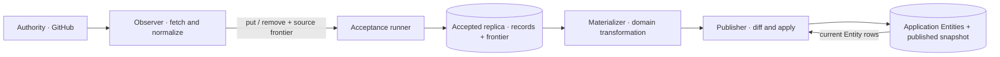

A Replicated Versioned Model is a maintained representation of an authoritative source. It
records **which source revision it incorporates** and **which version of the derivation produced
it**. For example, Atlas reads GitHub pull requests and derives Evidence Bindings from their
directives.

## From source to Entities



The accepted replica holds **source-shaped records**. The published snapshot and Entity rows
hold **application-shaped output**. In Atlas, one normalized PR can produce several Evidence
Bindings. Removing one directive can remove a binding while the PR stays in the replica.

An observation can contain a put for a changed PR and a removal for a PR that left the source
scope. The put carries the normalized record. The removal carries only its stable source ID.

```ts
const changes = [
  { kind: 'put', id: 'pr:42', record: { number: 42, body: updatedBody } },
  { kind: 'remove', id: 'pr:17' },
] as const;
```

## Declarative Entity publication

An Entity can colocate its mapping from observed data with its fields, commands, and reactions.
A relationship represented by an Entity can also declare the inputs to its derivation.

```ts
const PullRequest = entity({
  name: 'PullRequest',
  fields: pullRequestFields,
  replicated: { source: mapAcceptedPullRequests },
});

const EvidenceBinding = entity({
  name: 'EvidenceBinding',
  fields: evidenceBindingFields,
  replicated: {
    from: () => [PullRequest, Plan],
    derive: mapResolvedEvidence,
  },
  reactions: evidenceBindingReactions,
});
```

`prepareReplicatedEntityPublication` compares the declared output with current rows and prepares
ordinary mutation commands. In Atlas, the Evidence Binding reactions emit an Event after commit.
`from` orders writes within the publication group. Ontahí writes dependencies first and removes
dependents first. The application supplies observed input, scope coverage, and the transaction
that accepts publication. The Observer and Materializer runners remain the execution model
underneath the declaration. When the host observes a new
revision, a changed declared input invalidates the derived checkpoint. In Atlas, renaming a Plan
can re-resolve a binding even when the accepted GitHub record and frontier stay the same.

An omitted nullable field is published as `null`. Clearing a previously stored non-nullable
field requires a representation the Entity's schema supports. Publication rejects that omission
before it applies commands.

## How the runners compose

The runners below show the flow behind the declaration. The example uses the current Core APIs
with an application-owned adapter, Materializer, and publisher.

```ts
import {
  createReplicatedCollectionAcceptanceRunner,
  createReplicatedVersionedMaterializerRunner,
} from '@ontahi/core';

const replica = createReplicatedCollectionAcceptanceRunner(githubObserver, {
  collectionId: 'github:owner/repo:pull-requests',
  activeStorage: entityStorage,
});

const model = createReplicatedVersionedMaterializerRunner(evidenceMaterializer);

const observation = await replica.run((await replica.current()) ? 'incremental' : 'bootstrap');
if (observation.status === 'accepted' && observation.snapshot) {
  const { frontier, records } = observation.snapshot;
  const derived = await model.run({
    mode: 'rebuild',
    sourceFrontier: frontier,
    input: records,
  });

  if (derived.result.status === 'accepted' && derived.output) {
    await publishEvidence(derived.output);
  }
}
```

This example uses a string frontier. It updates the **source replica incrementally** and derives
the output from the **whole accepted replica**. The application can introduce incremental
derivation separately. Atlas already uses the collection runner for GitHub evidence and owns
its projection orchestration.

| Piece        | What the application implements                                                                                                                                                                                              |
| ------------ | ---------------------------------------------------------------------------------------------------------------------------------------------------------------------------------------------------------------------------- |
| Observer     | `observe(acceptedFrontier, mode)` fetches source changes and returns `changes`, `targetFrontier`, `fetched`, `completeness`, and diagnostics. GitHub pagination and `updated_at` rules live here.                            |
| Materializer | Give it an `id` and `version`. `derive(input, context)` returns state, artifacts, changes, dependencies, and diagnostics. For incremental derivation, `affectedBy(delta, dependencies)` identifies the outputs to recompute. |
| Publisher    | Map derived output to Entity rows and decide when to publish. The Entity publication diff and ordered transaction helpers are the [Plan 174 slice](../../../plans/current/174-incremental-entity-publication.md).            |

## What gets accepted and persisted

- **Replica.** The runner applies idempotent puts and removals to a candidate. Complete
  observations can bootstrap or repair the replica. Validation compares without writing. A
  store-owned revision fences late writers. The runner reports fetched, changed, reused, and
  resulting counts. The application's active Entity store supplies the replica capability by
  default. Records are internal to the collection. Use a custom adapter when the active store
  lacks that capability.
- **Derivation.** The reference runner keeps the accepted output, its source frontier,
  Materializer version, and dependency index in memory. The application can persist and
  hydrate that checkpoint. A missing baseline, frontier gap, changed Materializer version, or
  unknown affected set requests a rebuild.
- **Publication.** The application defines row equality and proves which omissions mean
  deletion. Plan 174 protects rows with newer accepted positive events and applies the writes
  and revision claim in the active Entity transaction. A failed write rolls back the batch and
  its claim. A rebuild serves as the equivalence check.
