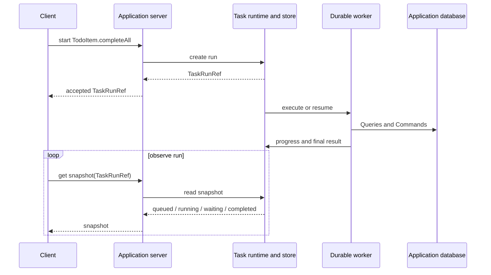

# Durable Operations

A \concept{Durable Operation} is a domain operation whose work continues beyond its initial invocation.
Starting it returns the identity of a run. Progress, completion, and failure are observed through
that run.

## Declare one lifecycle

`completeAll` declares its eventual output and progress alongside the operation:

```ts
const CompleteAllProgress = value('CompleteAllProgress', {
  phase: f.enum(['updating'] as const),
});

const CompleteAllOutput = value('CompleteAllOutput', {
  completed: f.nonNegativeInteger(),
});

completeAll: operation({
  output: CompleteAllOutput,
  durable: {
    runtime: 'in-process',
    progress: CompleteAllProgress,
  },
  run: runCompleteAll,
}),
```

The input schema, contracts, requirements, progress schema, and final output remain one operation
contract. Ontahí projects the task definition that the configured runtime executes.

The operation body receives a task context when the runtime runs it. It can report progress, sleep
without hiding timing semantics, and execute declared steps. In this example `runCompleteAll`
reports the `updating` phase, completes the open Todos, and returns `CompleteAllOutput`.

> [!MARGIN] **One operation, not a command plus a job.** A queue-based application often repeats
> the same use case as an endpoint contract, job payload, status record, and polling DTO. Ontahí
> projects those runtime shapes from the durable operation's lifecycle contract instead of asking
> the application to author a second model.

## Start and follow it from Node

```ts
import { setTimeout as wait } from 'node:timers/promises';
import { TodoItem, TodoApplication } from './graph.js';

const started = await TodoItem.completeAll();
if (!started.ok) throw new Error(started.message);

const run = started.value;
let snapshot = await TodoApplication.getTaskSnapshot(run);

while (
  snapshot.status === 'queued' ||
  snapshot.status === 'running' ||
  snapshot.status === 'waiting'
) {
  await wait(500);
  snapshot = await TodoApplication.getTaskSnapshot(run);
}

console.log(snapshot.status, snapshot.result ?? snapshot.error);
```

`started.value` is a `TaskRunRef`: `taskId`, `runId`, and the status at acceptance. It is not the
final `CompleteAllOutput`.

The snapshot carries the current status, progress, eventual result, or run error. Keeping the Ref
separate lets another process, request, or screen resume observation without restarting the work.

The lifecycle crosses runtimes without changing its identity:



Acceptance, execution, persistence, and observation may happen in different processes. The
`TaskRunRef` is what keeps them one run.

## Observe the same run from React

```tsx
const completeAll = useDurableOperation(TodoItem.domain.completeAll);

return (
  <div>
    <button disabled={completeAll.isExecuting} onClick={() => completeAll.execute()}>
      Complete all
    </button>

    {completeAll.value && <small>Run {completeAll.value.runId}</small>}
    {completeAll.isQueued && <p>Queued…</p>}
    {completeAll.isRunning && <p>{completeAll.progress?.phase ?? 'Running…'}</p>}
    {completeAll.isWaiting && <p>Waiting for a response…</p>}
    {completeAll.isCompleted && <p>Completed {completeAll.finalValue?.completed ?? 0} Todos.</p>}
    {completeAll.isFailed && <p>{completeAll.runError?.message}</p>}
  </div>
);
```

`value` is the accepted run Ref. `finalValue` is the typed eventual output. The hook keeps start
failure separate from run failure: a failed invocation creates no run; an accepted run may later
reach `failed` or `cancelled`.

Reads invalidated by the operation become stale after successful completion, not merely after the
runtime accepts the start request.

## Snapshots are the observation contract

The Runtime Protocol represents observation as a versioned `durable.operation` request. Starting
the work remains `operation.invoke`; after receiving its `TaskRunRef`, a runtime can inspect that
identity:

```ts
{
  version: 1,
  kind: 'inspect',
  run: { taskId: 'Todo.completeAll', runId: 'run-1' },
}
```

The response is a versioned `snapshot` containing queued, running, waiting, completed, failed, or
cancelled state plus progress, a pending Interaction, result, or error when present. `waiting`
means execution has checkpointed either an Interaction or an Event wait. Inspect
`snapshot.waitingOn` to distinguish them. An authorized Interaction response or a matching
retained Event must claim that checkpoint before the run returns to `running`. Progress, Interaction, and result are snapshot states, not commands.
Repeating `inspect` is the portable polling primitive.

The React boundary is one Runtime Transport observer. `useDurableOperation` consumes its
asynchronous snapshot sequence; the transport chooses how to produce it from its capabilities. The
Fetch transport polls with repeated `inspect` requests and stops at `completed`, `failed`, or
`cancelled`. The WebSocket transport subscribes once and receives the same snapshots by push,
without changing component code, lifecycle state, or completion-time cache invalidation.

Polling cadence belongs to Fetch configuration, not the hook:

```ts
const client = createFetchGraphClient({
  runtimeTransport: {
    endpoint: '/runtime/ontahi/runtime',
    durableOperation: { pollIntervalMs: 750 },
  },
});
```

Or select pushed observation explicitly:

```ts
const runtimeTransport = createWebSocketRuntimeTransport({ url: '/runtime' });
const client = createRuntimeGraphClient({ runtimeTransport });
```

The WebSocket observer releases the session subscription when the hook aborts or a terminal
snapshot arrives. It ignores duplicate, out-of-order, mismatched-run, and post-terminal delivery.
A disconnect ends active observation without replay or automatic resubscription; WebSocket alone
does not imply durability or exactly-once delivery. A host whose Task Runtime only supports
inspection may poll on the server and push changed snapshots, while the browser still performs no
polling.

The conventional same-origin client uses `POST /runtime` for invocation, Graph Read, Graph Command,
and inspection. `OntahiGraphProvider` exposes the same Runtime Transport capability consumed by the
Durable hook. Express requires an explicitly configured common dispatcher and trusted
request-context factory before mounting that path; it does not expose Task state automatically.
The legacy Task snapshot GET remains only as a bounded compatibility surface during endpoint
migration.

## Configure the execution runtime

Choose an executor, a Task Storage implementation, and, for Event waits, a durable Event
Runtime. Data Graph storage is an independent setting. Start and observe runs through the same
Operation contract in every configuration. See the [adapter capability matrix](../03-runtimes/05-adapter-capability-matrix.md)
for the tested combinations.

For local development, start with `inProcessTasks()`. Its default Task Storage lives in memory.
Use an explicit `durable.execution` when a run must resume across a process boundary or wait for
an Interaction or Event. An explicit step returns a transition with JSON-safe state, or it
returns the final result. A worker may evaluate a step again after a crash.

### PostgreSQL worker

Apply the Task schema with `createPostgresTaskSchemaSql` and, for retained Events, apply
`createPostgresEventSchemaSql`. The application accepts the run and the worker polls the same
Task tables.

```ts
import { inProcessTasks, ontahi } from '@ontahi/core/runtime/server';
import { createPostgresEventRuntime } from '@ontahi/postgres/events';
import { createPostgresTaskStorage, createPostgresTaskWorker } from '@ontahi/postgres/tasks';

const taskStorage = createPostgresTaskStorage({ pool });
const eventRuntime = createPostgresEventRuntime({ pool });

const application = ontahi({
  storage,
  entities,
  tasks: inProcessTasks({ storage: taskStorage, deferExplicitExecution: true }),
  eventRuntime,
  events: declarations,
});

// Run this in the worker host with the projected Task definitions.
const worker = createPostgresTaskWorker({
  pool,
  tasks: taskDefinitions,
  events: { declarations },
});

const claimedRun = await worker.runOnce(signal);
```

Use a direct or session-pooled connection. The worker uses a fixed database-clock lease.
Set `leaseMs` to cover the longest attempt through its next persisted wait or terminal state.
Loop over `runOnce` in the worker host, back off when it returns `undefined`, and pass a shutdown
signal. The [Todo export integration](../../../examples/todo-express/src/postgres-durable-export.integration.test.ts)
shows how to project a domain Operation into a worker Task definition.

### LangGraph

Use persistent Task Storage and provide a LangGraph checkpointer. This configuration pairs the
same PostgreSQL Tasks and Events with the SQLite saver used by the restart test.

```ts
import { SqliteSaver } from '@langchain/langgraph-checkpoint-sqlite';
import { langGraphTasks } from '@ontahi/runtime-langgraph';

const tasks = langGraphTasks({
  storage: taskStorage,
  checkpointer: SqliteSaver.fromConnString(sqlitePath),
  events: { runtime: eventRuntime, declarations },
});

const application = ontahi({ storage, entities, tasks, eventRuntime, events: declarations });
```

Each replacement host opens the same persisted Task state and checkpointer. Task Storage with
conditional writes enables lease renewal, takeover, cancellation, and Event waits.
Snapshot reads and active observation drive Event polling. Schedule those reads in a host
that needs to advance waits while nobody is observing a run. `MemorySaver` is suitable for
process-local development. See the [LangGraph adapter README](../../../packages/runtime-langgraph/README.md).

### Vercel Workflow

Generate the workflow and step modules from the analyzed application with
`renderVercelWorkflowModules`. Connect the generated `getTaskWorkflow` resolver to
`createVercelWorkflowTaskRuntime` and pass `tasks: { runtime }` to `ontahi`. In the host worker
module, export the executor functions imported by the generated entrypoints. Both use the
same persistent Task Storage.

```ts
import { createVercelWorkflowTaskRuntime } from '@ontahi/runtime-vercel-workflows/runtime';
import { createVercelWorkflowTaskExecutor } from '@ontahi/runtime-vercel-workflows/executor';

const runtime = createVercelWorkflowTaskRuntime({
  taskRunStore: taskStorage,
  resolveWorkflow: getTaskWorkflow,
});
const application = ontahi({
  storage,
  entities,
  tasks: { runtime },
  eventRuntime,
  events: declarations,
});

// In the host module imported by the generated worker entrypoints.
const executor = createVercelWorkflowTaskExecutor({
  taskRunStore: taskStorage,
  getTaskDefinition,
  createExecutionContext,
  events: { runtime: eventRuntime, declarations },
});
export const runTaskInVercelWorkflow = executor.runTask;
export const runTaskStepInVercelWorkflow = executor.runTaskStep;
```

Supply the application Task definitions through `getTaskDefinition` and rehydrate graph resources
with `createExecutionContext`. Tag the Operations selected by the generator with `durable.runtime: 'vercel-workflow'` and
deploy the generated modules through the host's Vercel Workflow build integration.
See the [Vercel Workflow adapter README](../../../packages/runtime-vercel-workflows/README.md).

### Cancel from a trusted server

For the deferred PostgreSQL setup, use `worker.cancel(ref)`. With Vercel Workflow or LangGraph
and conditional Task Storage, use the configured Task runtime's `cancel(ref)`. Use
`cancelEventWait(ref)` for a pending Event subscription in those adapters. Authorize the caller
in your host before exposing either action. Cancellation fences later Task writes. An external
request already sent can still commit and may need reconciliation.

## Admit a run and protect its external effects

A durable Operation can set `idempotency.policy` to `reuse-running` or `skip-if-completed`
with a compatible executor and atomic Task Storage. Both policies reuse a queued, running,
or waiting run. After completion, only `skip-if-completed` reuses that run. An ordinary
failed or cancelled run releases the key. A run with an ambiguous external effect retains the
key and returns `reconciliation-required` on another matching invocation.

Use `idempotency.key(input)` for a business-defined equivalence key. It takes precedence over a
trusted webhook delivery identity. Keys are scoped by Operation and invocation authority. Run
references distinguish `created`, `reused`, `already-completed`, and
`reconciliation-required` for these policies. Apply the updated Task schema when using PostgreSQL.

For a provider that accepts idempotency keys, declare the effect with
`defineIdempotentTaskEffect({ id, retryWindowMs, execute })`. In explicit Task execution, call
`prepare(context, occurrence, input)` and return a `continue` transition with the prepared
value in its state. The next step calls `run(prepared)`. The persisted checkpoint carries the
provider key and input across worker recreation. Give separate logical calls separate occurrence
identities. Configure a conservative retry window supported by the provider.

A worker can send the same effect request more than once. The provider must enforce its contract
for the same key and input. If the window expires, the Task retains the checkpoint and records
an ambiguous outcome for reconciliation. The effect declaration covers that capability's calls.
List the helper's `metadata` in `durable.externalEffects` to expose that declared contract in
reflection. Coverage of other effects in arbitrary TypeScript remains unverified.

### Reconcile by external reference

For an API with a reference lookup, use `effect.reconcilable({ lookup, execute })`.
The declaration ID is optional. Give each logical use a stable occurrence unique within its Task
run. For repeated uses, derive the occurrence from a business key. Persist the prepared value in
an explicit Task checkpoint before running the effect. The helper
looks up that reference before writing and recovers any matching record. After an uncertain
write, it reconciles and issues at most one retry per execution of the helper. If that retry fails, it looks up the reference
once more. An inconclusive or unavailable lookup leaves a failed run with
`task_effect_outcome_ambiguous` and its prepared checkpoint. Starting with the same key returns
the original run with `reconciliation-required`, without launching another execution.

Have the adapter report expected HTTP and transport failures in the Effect error channel.
Return `confirmed-absent` only when the provider contract establishes that the record does
not exist and no earlier write can still commit for that reference. A search miss after a
timeout from an eventually consistent API is `unknown`. Compare the returned record and expected
input before returning `found`. Lookup and creation are separate provider actions. Hosts that
run competing workers need exclusive execution for the effect or a provider guarantee that
prevents conflicting creates for the same reference.

For an executable example with the prepare and write steps, see the
[shared reconciliation fixture](../../../packages/core/src/runtime/server/tasks/reconciliation-conformance.ts).
