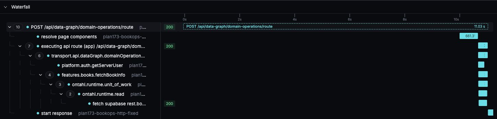

# Observability

Ontahí's server runtime emits traces through a provider-neutral telemetry adapter.
`@ontahi/opentelemetry` connects that adapter to the host's OpenTelemetry SDK.
The host configures service identity, sampling, export, and redaction. The examples
below describe the tracing surface introduced by [PR #360](https://github.com/javifernandes/ontahi/pull/360).
Use a release or local package build that includes it.

## Connect the server runtime

Install `@ontahi/opentelemetry` at the same version as your other Ontahí packages.
For a Node host with no telemetry bootstrap yet, install `@opentelemetry/sdk-node`
and `@opentelemetry/exporter-trace-otlp-http`, then configure both pieces at startup.

```ts
import { OTLPTraceExporter } from '@opentelemetry/exporter-trace-otlp-http';
import { NodeSDK } from '@opentelemetry/sdk-node';
import { configureServerRuntime } from '@ontahi/core/runtime/server';
import { createOpenTelemetryServerRuntimeTelemetryAdapter } from '@ontahi/opentelemetry';

const sdk = new NodeSDK({ traceExporter: new OTLPTraceExporter() });
sdk.start();

configureServerRuntime({
  telemetry: createOpenTelemetryServerRuntimeTelemetryAdapter({
    tracerName: 'my-app.server',
  }),
});
```

Initialize the SDK and its instrumentation before importing instrumented drivers
or accepting requests, and
await `sdk.shutdown()` during graceful shutdown. If the host already initializes
OpenTelemetry, reuse that SDK and add the adapter to the host's existing
`configureServerRuntime` call.

## SigNoz for local development

Start [self-hosted SigNoz](https://signoz.io/docs/ingestion/self-hosted/overview/)
with its OTLP/HTTP collector reachable from the host. For an application running
on the same machine, set these variables before starting it:

```dotenv
OTEL_SERVICE_NAME=ontahi-local
OTEL_EXPORTER_OTLP_PROTOCOL=http/protobuf
OTEL_EXPORTER_OTLP_ENDPOINT=http://localhost:4318
OTEL_TRACES_SAMPLER=always_on
```

Invoke a server Operation that reads or writes data. In SigNoz, open Traces, select
`service.name=ontahi-local`, and open an invocation. Use the collector's network
address instead of localhost if the application runs in a separate container.
This local path was verified with Atlas and BookOps.



The request used a synthetic missing book slug and local Supabase. Read the indentation
for parentage. The request duration includes development-server startup work.

## Axiom as a managed destination

Create an Axiom dataset and an ingestion token. Keep the token in server-side
configuration and use the ingest domain for your Axiom deployment. In the Node
bootstrap above, pass these options to `OTLPTraceExporter`:

```ts
const traceExporter = new OTLPTraceExporter({
  url: `https://${process.env.AXIOM_DOMAIN}/v1/traces`,
  headers: {
    Authorization: `Bearer ${process.env.AXIOM_TOKEN}`,
    'X-Axiom-Dataset': process.env.AXIOM_DATASET!,
  },
});
```

Pass `traceExporter` to `NodeSDK` and choose the dataset in Axiom's Traces view.
See [Axiom's OpenTelemetry setup](https://axiom.co/docs/send-data/opentelemetry)
for endpoint and authentication details. Other OTLP-capable destinations include
[Grafana Cloud](https://grafana.com/docs/grafana-cloud/send-data/otlp/send-data-otlp/),
[Honeycomb](https://docs.honeycomb.io/send-data/telemetry-pipeline/sources/opentelemetry),
and [Jaeger](https://github.com/jaegertracing/jaeger/blob/main/README.md).
Their endpoint, authentication, and visualization depend on the destination.

## Read an Ontahí trace

- An Operation can enclose a root Unit of Work. Nested Operations and logical reads
  and commands appear under their active execution parent.
- A transaction span covers the provider transaction. PostgreSQL driver spans are
  separate and appear when the host enables `pg` instrumentation. Post-commit work
  runs after the transaction commits.
- A model attempt records success, admission rejection, or execution failure.
- A durable Task attempt has a persisted ordinal on supported Task storage. A worker
  or resumed execution can have a new trace ID, with a span link back to the enqueue
  span. The Task ordinal is separate from retries inside an Operation. Apply the
  updated Task schema before using this with PostgreSQL.

Inspect the attributes produced by host-side database and HTTP instrumentation
before exporting real traffic. Strip query strings and avoid credentials, payloads,
and SQL parameter values. The [integration index](07-integrations.md) links the
runtime-specific capability and setup references.
