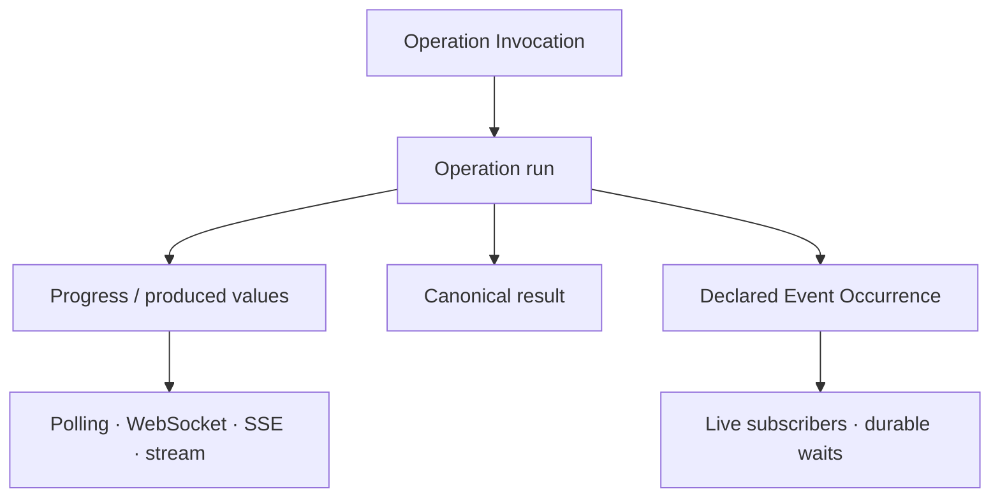

# Continuous Execution

Durable work already has two observation paths: Fetch polls, while WebSocket pushes snapshots of
the same `TaskRunRef`. WebSocket also carries supported Graph Query observations. These are current
contracts, described in [Runtime Transport](../03-runtimes/03-transport-and-http-ingress.md), not
future Event APIs.

The remaining direction is broader: SSE or gRPC adapters, resumable delivery, and Operations that
naturally produce many values need explicit contracts for identity, ordering, backpressure,
completion, failure and reconnection. None follows merely from having a socket.

First-class Events are now a current contract rather than a further direction. See
[Events](../02-core-concepts/10-events.md) for declaration, occurrence and delivery identity,
ephemeral and durable runtimes, external ingress, durable waits, and live browser observation.
General Event history, cursor replay, broker egress, and arbitrary durable processing remain future
work; they do not follow automatically from the current live subscription or claim contracts.

Future continuous execution can build on those Event identities without redefining them. It still
needs its own contracts for resumable streams, backpressure, ordering, terminal state, and replay.
